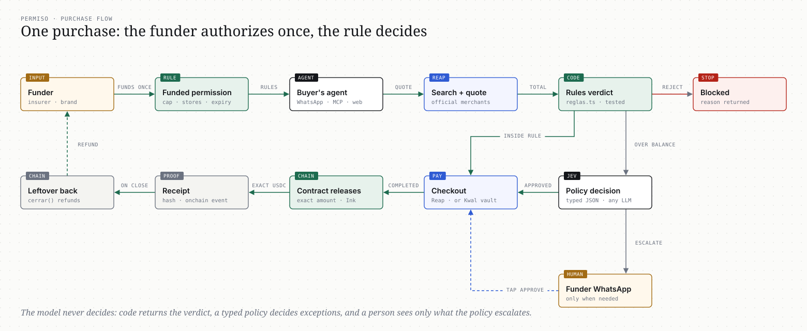
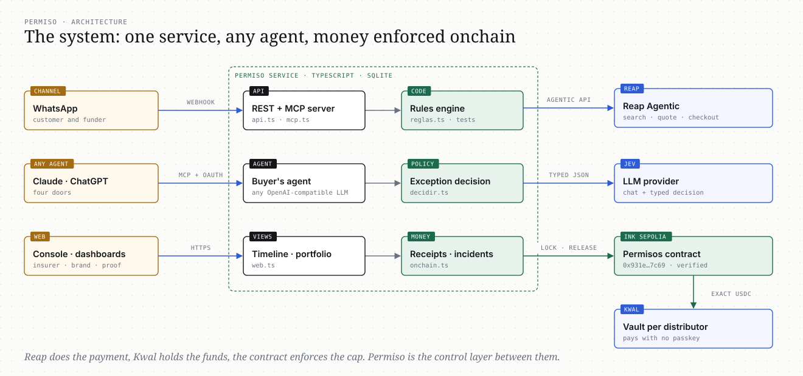

# Permiso

**Your money, their choice, your rules.**

Permiso lets a company fund a purchase that someone else makes, without cash payouts or reimbursements. You set the budget and the rules once. The person buys through an assistant that only sees what you allow. You get the receipt, and what they don't spend comes back.

Built at the Reap x AI Builders MX Agentic Buildathon (Mexico City, October 2026). Sandbox only: no real money moves.

Live demo: https://permiso.nostris.dev · Proof of what ran: https://permiso.nostris.dev/prueba.html

## For reviewers: the idea in 30 seconds

Agents can already buy things. What nobody has solved is a company letting **someone else's** agent spend **its** money: an insurer paying a claim in kind, a brand funding its distributors. Today that is cash (fraud, no proof) or reimbursement (weeks, paperwork). Permiso is the control layer in between: the funder authorizes once (a rule with a budget), the other person's agent buys inside it through Reap, exceptions are decided by the funder's policy, and every purchase leaves a receipt. For brand funds the money sits in a smart contract that can only release what the rule allows.

Where the key ideas live in the code:

| Idea | File |
|---|---|
| The rule decides, not the model (inside / needs approval / blocked) | `src/reglas.ts` (with tests in `test/reglas.test.ts`) |
| Funder authorizes once; exceptions decided by policy as a typed decision | `src/decidir.ts` |
| The agent buys only through Reap's Agentic checkout | `src/reap.ts`, `src/servicio.ts` (`opciones`, `cotizar`, `comprar`) |
| Money enforced onchain: lock, exact release, receipt, refund | `contratos/Permisos.sol`, `src/onchain.ts` |
| Hands-free payment from each distributor's own Kwal vault, in parallel | `src/kwal.ts`, `comprarSinManos` in `src/servicio.ts` |
| Any agent can plug in: MCP with four doors behind OAuth | `src/mcp.ts`, `src/oauth.ts` |
| Runs without keys for review | `src/replay.ts`, `npm run demo` |

### How it works, in two pictures





## The problem

When a company pays for something another person chooses, it has two bad options. Hand over cash and hope it is spent right. Or make the person pay first, collect receipts, and reimburse weeks later. The first invites fraud. The second costs a claims handler per file and an angry customer per delay.

Insurers live this on every claim. Brands live it on every dollar of marketing funds they give distributors, which is why about 60% of those funds go unused (Omdia, as quoted by TechCentral and Ansira).

Corporate cards control your employees. Permiso controls spending by people you don't employ.

## How it works

1. **You fund a rule.** Amount, what is allowed (stores and categories from Reap's supported list), until when, and who decides exceptions. Optionally the money is locked in a smart contract.
2. **They buy inside it.** On WhatsApp, in ChatGPT or Claude (MCP), or on a web page. The assistant only shows what the rule allows, quotes the real total with shipping through Reap, and buys through Reap's Agentic checkout.
3. **You get proof, not paperwork.** Every purchase gets a verdict from rules written in code: inside, needs approval, or blocked. Exceptions are decided by your policy (a typed decision, not a chat model) with the reason written in the purchase timeline. A person is notified on WhatsApp only when the policy cannot decide, and answers "aprobar" or "rechazar". Each purchase has a receipt; closing returns the leftover.

## Who it is for

- **Insurers and warranty providers:** in-kind replacements. "Equivalent replacement up to 120 USD, audio stores, 7 days." The customer picks the model; the insurer gets the order as proof and the difference back.
- **Brands with distributor networks:** co-op and marketing funds, locked per distributor in a contract on Ink Sepolia. No claims, no 90-day reimbursement; an auditor can verify onchain.
- **Any company that pays for what contractors, patients, students or beneficiaries choose.** Same engine, another template.

Pricing: per purchase settled, or a percentage of funds managed. No setup fee.

## Four doors

Run `npm run demo`, then add `http://127.0.0.1:3066/mcp` (or a public tunnel to it) as a custom connector in Claude or ChatGPT. The authorization page asks for the access code (`demo` in replay mode) and which door:

| Door | What you get |
|---|---|
| Insurer | Create permissions, see transactions and incidents, decide escalated exceptions |
| Insurer's customer | A test claim with 120 USD; search, quote and buy a replacement |
| Brand | Create funds per distributor, locked in the contract |
| Distributor | A test fund with 150 USD onchain; buy equipment inside it |

Spender tools: `ver_permiso`, `buscar_opciones`, `cotizar`, `comprar`, `estado_compra`. Funder tools: `crear_permiso`, `listar_permisos`, `excepciones_pendientes`, `aprobar_excepcion`, `rechazar_excepcion`, `cerrar_permiso`, `auditoria`.

## WhatsApp: two people, two numbers

WhatsApp is where the two sides of a permission meet, without anyone installing an app or logging in.

| Who | What they do on WhatsApp |
|---|---|
| The buyer (insurer's customer) | Sends the permission link to the bot, then talks normally: "my headphones were stolen". The agent searches only allowed stores, quotes with shipping, and buys. |
| The funder (insurer or brand, on its business number) | Receives only what needs a human: Reap approval links for purchases, and exceptions the policy escalated. Replies `aprobar ex_…` or `rechazar ex_…` to close one. Several can be pending at once; none blocks another. |

How it is wired (`src/canal.ts`):

- Permiso does not talk to WhatsApp directly. The bridge in [`bridge/`](bridge/) holds the WhatsApp session (Baileys, paired by QR with any number) and calls Permiso for every inbound message: `POST /canal/whatsapp` with a bearer token and `{ id, chat, numero, texto }`. Permiso answers 200 immediately and replies asynchronously through the bridge's `POST /enviar { chat, texto }` (plus `POST /escribiendo` for the typing indicator). Any WhatsApp provider that can make that call and accept that send works, including the WhatsApp Cloud API.
- A chat is tied to a permission only when the buyer sends its capability link (`/p/t_…`). Without the link there is no permission, so a stranger writing to the bot gets nothing.
- The funder is recognized by its number (sent by the authenticated bridge, not by the message text). Group chats are ignored.
- The buyer's agent uses the same tools as the MCP (`ver_permiso`, `buscar_opciones`, `cotizar`, `comprar`, `estado_compra`) through any OpenAI-compatible LLM (`LLM_BASE_URL`, `LLM_API_KEY`, `LLM_MODEL`). Verdicts come from the rules, never from the model, and it never shows internal codes to the person.
- Proactive messages: a purchase watcher tells the buyer when a store confirms, fails or stalls (Reap's agentic module has no webhooks, so Permiso polls), and incidents also notify the funder.

Configuration: `WHATSAPP_BRIDGE_URL`, `WHATSAPP_BRIDGE_TOKEN` (shared with the bridge) and `FUNDER_WHATSAPP` (the funder's chat, for example `5217711234567@s.whatsapp.net`). Without them the WhatsApp channel is off and everything else works. To run it: `cd bridge && npm install && BRIDGE_TOKEN=... AGENT_URL=http://127.0.0.1:3066 ALLOWED_NUMBERS=52155...,52177... npm start`, scan the QR with the bot's phone, and set the same token in the agent.

## Onchain (track 2)

Contract `Permisos` on Ink Sepolia: `0x931e92fe62310bc67ffe016c3c8f55afd31f7c69` ([explorer](https://explorer-sepolia.inkonchain.com/address/0x931e92fe62310bc67ffe016c3c8f55afd31f7c69)).

- `crear` locks the funder's USDC with spender, cap, expiry, approver and a hash of the rules.
- `autorizar` releases exactly the completed purchase amount to the spender's Kwal vault (Payward's wallet that backs the card). Only the operator, only inside the cap, only before expiry.
- `aprobar` lets the approver add the difference for an exception, with real funds.
- `recibo` records the receipt hash as an event.
- `cerrar` refunds the leftover to the funder.

The money itself enforces the rule: the card can only spend what the contract released. Sandbox scale: 1 USD of a permission = 0.01 test USDC.

## Architecture

One TypeScript service (Node 22, Express, SQLite).

| Piece | File |
|---|---|
| Rules engine, pure and tested | `src/reglas.ts`, `test/reglas.test.ts` |
| Policy decisions for exceptions (typed JSON from any OpenAI-compatible model; we used Jev, a typed router, as `DECISION_MODEL`) | `src/decidir.ts` |
| Reap Agentic client: enrollment, search, details, quotes, cheapest shipping, checkout, polling, retries | `src/reap.ts` |
| Service: permissions, options, quotes, purchases, exceptions, receipts, incidents, close, audit | `src/servicio.ts`, `src/incidentes.ts` |
| REST API | `src/api.ts` |
| MCP server (streamable HTTP) with OAuth 2.1 (known clients, access code, PKCE, revocable tokens) | `src/mcp.ts`, `src/oauth.ts` |
| WhatsApp channel and the customer's agent (any OpenAI-compatible LLM, same tools as the MCP) | `src/canal.ts` |
| Console, claim page, purchase timeline, demo page | `src/web.ts` |
| WhatsApp bridge (Baileys, QR pairing, allowed numbers) | `bridge/` |
| Contract and onchain hooks | `contratos/Permisos.sol`, `src/onchain.ts` |

## Evidence (sandbox, October 9 2026)

Everything below ran for real on Reap's sandbox and Ink Sepolia. The Reap sandbox key expires after the hackathon; the contract and its transactions are permanent and public.

- Proof page (frozen, no login): https://permiso.nostris.dev/prueba.html
- Contract `Permisos`: [`0x931e92fe62310bc67ffe016c3c8f55afd31f7c69`](https://explorer-sepolia.inkonchain.com/address/0x931e92fe62310bc67ffe016c3c8f55afd31f7c69) on Ink Sepolia (chain 763373): 40 transactions tonight (funds locked, exact releases, receipts, refunds on close).
- Three insurance purchases were approved from the funder's WhatsApp at the same time and completed independently within seconds.
- Distributors buy in parallel, each from its own Kwal vault. One purchase was paid by the vault with no human approval; another was refused by the contract itself (`PasaDelTope`) because it would have exceeded the cap.

| When (UTC) | Permission | Product | Amount | Paid via | Reap order | Receipt onchain |
|---|---|---|---|---|---|---|
| 2026-10-10 02:32 | Prueba de tienda (Linsoul) | 7HZ Salnotes Zero | 31.99 USD | Reap Agentic checkout | `ord_01M4HTD1DAY48KD8E0YCTPB05Y` | [tx](https://explorer-sepolia.inkonchain.com/tx/0x3677e7cc389f4e1e4a58de47beb0d423b62a69906b713410b04431fff038be79) |
| 2026-10-10 03:51 | Fondo co-op Q4 · Distribuidora Bajío | It Girl Sticker Pack | 3.95 USD | Kwal (bóveda, sin aprobación humana) | `-` | [tx](https://explorer-sepolia.inkonchain.com/tx/0x5b2386cd5696917b02f1179129ecb1c11677a23e96e3a1805fbae4d624b95188) |
| 2026-10-10 04:01 | Reposición de audífonos robados | 7HZ Salnotes Zero | 31.99 USD | Reap Agentic checkout | `ord_01M4HZGNMM3JQBB6X8KN5TJ5DX` | [tx](https://explorer-sepolia.inkonchain.com/tx/0x3f2e8822b372e406c8532d3fa38dcdcc2459ff401099aa1ebe4d994052b3e083) |
| 2026-10-10 04:01 | Reposición de audífonos robados | 7HZ Salnotes Zero | 31.99 USD | Reap Agentic checkout | `ord_01M4HZGSA0WMKGBCMQWGJG5PE8` | - |
| 2026-10-10 04:02 | Reposición de audífonos robados | 7HZ Salnotes Zero | 31.99 USD | Reap Agentic checkout | `ord_01M4HZGXBHFZ1ENW4S8W8M68GG` | - |

## Run it yourself (no keys needed)

```
git clone https://github.com/miker778/fund-reap && cd fund-reap
npm install
npm run demo        # replay mode on http://127.0.0.1:3066
```

Replay mode simulates Reap and Kwal locally with Reap's official merchant catalog (same request and response shapes as the real APIs) so the whole product runs without sandbox keys:

- Insurer console: http://127.0.0.1:3066/consola/demo
- Three-column demo: http://127.0.0.1:3066/demo/demo
- Brand portfolio: http://127.0.0.1:3066/marca/demo ("Fondear distribuidores reales", then "Todos compran a la vez")
- MCP connector: http://127.0.0.1:3066/mcp, access code `demo`, any of the four doors. Claude and ChatGPT need a public URL, so expose it with a tunnel (for example `cloudflared tunnel --url http://127.0.0.1:3066`) and set `PUBLIC_URL` to it.
- The checkout approval page is local (`/replay/aprobar/<id>`); in the real sandbox it is Reap's page with a passkey.
- The onchain hooks are off in replay mode; the live contract above shows them on the real chain.

## Run against the real sandbox

```
npm install
cp .env.example .env    # fill REAP_API_KEY, FUNDER_TOKEN; optional LLM_*, WHATSAPP_*, DEPLOYER_KEY, CONTRACT_ADDRESS, KWAL_VAULT
npm test                # rules engine
npm start               # http://127.0.0.1:3066
node scripts/compilar.cjs
```

`scripts/dev/` holds the spikes used during the hackathon (enrollment, Kwal, bridge, deploy).

## Hackathon rules, checked

- No travel bookings: templates only allow audio, electronics, office and stationery stores.
- Only supported merchants: every search is `merchantPreference: ONLY` on a domain from Reap's official list (`catalogo/comercios.csv`), filtered by category and shipping country.
- No shortcuts around the Agentic module: cards are entered only on Reap's hosted page and charges are approved there; no checkout scraping; no card data ever reaches the code or a model.

## What the sandbox taught us

- `X-Simulate-Checkout` does not skip the hosted approval; every charge needs the cardholder's passkey. Reap mandates (approve once) are "coming soon"; they are the piece that makes the funder-authorizes-once model fully hands-free on Reap. Kwal's sandbox already pays from the vault without a passkey.
- Product search returns 503 whenever `filters.price` is set; price is filtered locally.
- The preselected shipping option is not always the cheapest; Permiso picks the cheapest before checking the rules.
- Quotes expire in about 10 minutes; late purchases are re-quoted and re-checked.
- One merchant left a checkout in `PROCESSING` for over an hour; that is why incidents exist.
